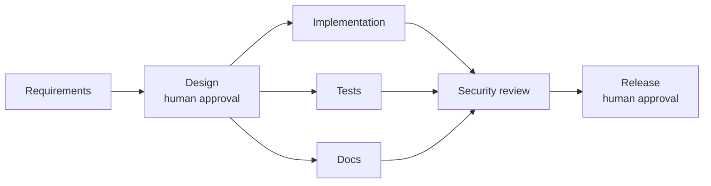
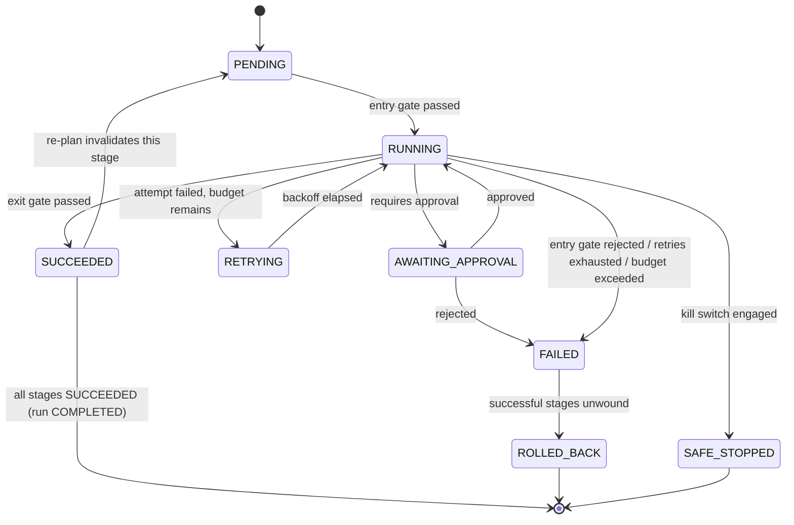

# Architecture

## Modules

- `shortener-service` — the Spring Boot URL shortener: create/redirect/metadata/stats/delete APIs,
  H2 + Flyway persistence, async click recording, SSRF/abuse guards, RFC 7807 errors, correlation IDs.
- `orchestrator-core` — the DAG engine: workflow plan validation (cycle detection), the run state
  machine, bounded retries with backoff, per-stage timeouts, a total-attempt budget, rollback,
  the kill switch, dynamic re-planning, the append-only audit event model, and reliability metrics.
- `policy-engine` — declarative policy-as-code. `policies.json` lists which rules are enforced and
  the data they check (allowed path prefixes, disallowed dependencies); `PolicyEngine` evaluates them.
- `agents` — the seven SDLC agent roles, their declared path/command boundaries, the offline/Anthropic
  completion client, and `PolicyGates`, which turns boundaries and policy rules into real DAG gates.
- `orchestrator-api` — wires the above into three runnable scenarios (`Scenarios.java`) and the demo
  entry point (`DemoMain.java`), which executes all three, renders `artifacts/demo-report.md`, and
  dumps each run's full artifact set and append-only audit trail.

## Control flow

Brownfield inserts an `impact-analysis` stage between requirements and design; ambiguous inserts a
`clarification` stage in the same slot. Both are concrete, non-generic stages — see SCENARIOS.md.

## Run state machine

`RunStatus` tracks the run as a whole (PENDING, RUNNING, AWAITING_APPROVAL, RETRYING, FAILED,
ROLLED_BACK, SAFE_STOPPED, COMPLETED); `StageStatus` tracks each node in the DAG independently, so
a run can show one stage RETRYING while a parallel sibling is SUCCEEDED.

## Key decisions

- **Dependency edges, not a separate declaration, define re-plan blast radius.** `WorkflowPlan`
  already encodes which stages depend on which; `OrchestrationEngine.rePlan` walks that same graph
  to compute the invalidated downstream subgraph. One source of truth for both execution order and
  re-plan scope.
- **A revised artifact is supplied, not regenerated.** When `rePlan` is called with a new value for
  an already-produced artifact, the engine does not re-run that stage's action — it accepts the new
  value (as a human architect handing over a revised document would), resets only the *downstream*
  dependents to PENDING, and re-runs the changed stage's approval gate if it has one. This was a
  real bug caught while verifying this feature: an earlier version let the changed stage re-execute
  its own action, silently discarding the revised value.
- **Policy evidence travels through `GateResult.policyResults`, not a side channel.** Every gate —
  agent-boundary, allowed-paths, tests-required, security-review-required, no-secrets — returns its
  verdicts in the same map that lands in the audit event, so the audit trail shows *why* a gate
  passed or failed, not just that it did.
- **Artifacts are hashed in the audit trail, values are written separately.** `AuditEvent` stores
  SHA-256 hashes of inputs/outputs (tamper-evident, cheap to store, safe to keep forever); the demo
  additionally writes each run's full artifact map to `artifacts/<runId>.artifacts.json` so a
  reviewer can see exactly what was produced without re-deriving it from hashes.
- **Run ids are timestamped.** An earlier version reused literal ids like `greenfield-1` across
  every invocation, so repeated demo runs kept appending to the same JSONL file forever and the
  reported event count stopped matching the file. Timestamped ids fix that; each run gets its own file.

## What this is not

This is a prototype, not a production orchestrator: there is no Postgres/Redis swap wired up (the
`LinkRepository`/`ClickEventRepository` interfaces make it possible, but it is not done), no
distributed execution, no real sandboxing of agent-run commands, and the Anthropic completion path
is implemented but untested in this environment (no API key is provisioned here). See
RISKS_AND_TRADEOFFS.md for the full list.
