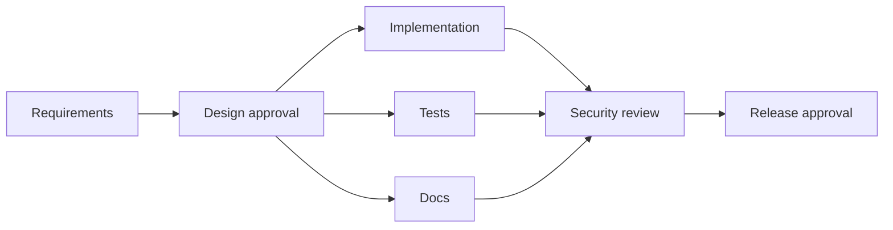

# Architecture

`shortener-service` owns APIs, H2/Flyway persistence and asynchronous analytics. `orchestrator-core` validates and schedules the DAG, records JSONL audit events, enforces gates/retries/rollback/safe-stop, and joins parallel branches. Agents declare roles and bounded paths; `policy-engine` evaluates declarative rules. The CLI demo writes audit evidence and a metrics summary under `artifacts/`.
